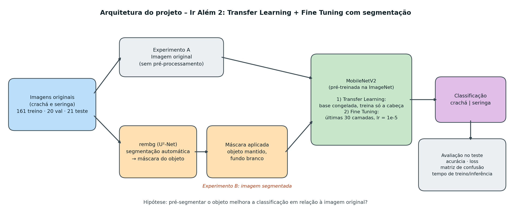

# FIAP - Faculdade de Informática e Administração Paulista

<p align="center">
<a href="https://www.fiap.com.br/">
  
</a>
</p>

<br>

# Detecção de Crachás e Seringas com YOLOv5s (PBL Fase 6 — Enunciado 1)


## 👨‍🎓 Integrantes: 
- <a href="https://www.linkedin.com/in/sabrina-otoni-22525519b/">Karina Queiroz de Gennaro | 570928</a>
- <a href="https://www.linkedin.com/in/sabrina-otoni-22525519b/">Luis Felipe Bardi | 569479</a>
- <a href="https://www.linkedin.com/in/sabrina-otoni-22525519b/">Beatriz de Oliveira Ossola Ribeiro	 | 570190</a> 


## 👩‍🏫 Professores:
### Tutor(a) 
- <a href="https://www.linkedin.com/in/sabrina-otoni-22525519b/">Sabrina Otoni</a>
### Coordenador(a)
- <a href="https://www.linkedin.com/in/andregodoichiovato/">André Godoi</a>


## 📜 Descrição

Este projeto foi desenvolvido como solução para o **Enunciado 1 da Fase 6 do PBL**, no qual se propôs a **ampliação das áreas de atuação da FarmTech** para ambientes de automação laboratorial, controle farmacêutico e segurança patrimonial avançada. 

Para atender a essas novas frentes operacionais, tornou-se fundamental implementar soluções de visão computacional focadas na detecção automatizada de **crachás de identificação** e **seringas** por meio da arquitetura **YOLOv5s** (Small), garantindo rastreabilidade, controle de acesso e segurança operacional em ambientes corporativos e farmacêuticos:
- **Crachás de Identificação (`cracha`):** Essenciais para o controle de acesso, rastreabilidade de equipe e conformidade com normas de segurança em áreas restritas da fábrica e dos laboratórios.
- **Seringas (`seringa`):** Fundamentais para a monitorização de linhas de produção farmacêutica, controle de estoque de insumos e auditoria automatizada de manipulação de medicação.

O treinamento foi realizado em ambiente computacional de nuvem (Google Colab) utilizando dados anotados no formato YOLO. O modelo final na **Simulação 4 (Expandida)** atingiu um desempenho médio geral (mAP@0.5) de **35.1%**, evidenciando comportamentos distintos entre as duas classes analisadas:
- **Crachá (62.5% mAP@0.5):** Apresentou alta consistência de localização e confiança, impulsionado por padrões geométricos retangulares bem definidos e superfícies opacas.
- **Seringa (7.69% mAP@0.5):** Revelou o desafio técnico clássico de redes neurais convolucionais diante de objetos finos, cilíndricos, translúcidos e altamente reflexivos.

A análise rigorosa dos testes práticos demonstra que a opacidade dos crachás facilita a extração de características pelas camadas do modelo, enquanto a transparência do vidro/plástico das seringas gera ruído visual em função das variações de fundo. Como roadmap para evoluções futuras (Simulação 5), planeja-se a inclusão de estratégias avançadas de *data augmentation* com foco em iluminação direcional, variação de contraste e fundos ruidosos.

Todos os relatórios de conclusão das 4 simulações realizadas encontram-se no Colab de forma organizada e justificada.
De forma a proporcionar uma leitura imersiva e o acompanhamento prático de cada etapa, **todo o passo a passo da solução, a contextualização dos objetos (`cracha` e `seringa`), os códigos de treino/validação e a descrição analítica completa** encontram-se documentados detalhadamente e prontos para execução no Notebook interativo:  
> 👉 **[Acessar Notebook Executável no Google Colab](https://drive.google.com/drive/folders/1-6sfF80J6KI_1Yia5Elcm9v7Hu0cIwjI?usp=sharing)** 

## 🔁 Entrega 2

Na Entrega 2 usamos a mesma base para comparar três abordagens:

- o YOLO customizado da Entrega 1;
- o YOLO padrão, isto é, o YOLOv5s pré-treinado no COCO, sem nenhum treino;
- uma CNN treinada do zero.

Também treinamos de novo o YOLO customizado depois de corrigir os rótulos de treino. A comparação
considera facilidade de uso, precisão, tempo de treino e tempo de inferência. Os resultados e a
análise estão no notebook.

- [Notebook executado](src/LuisFelipeBardi_rm569479_pbl_fase6_entrega2.ipynb) ·
  [Abrir no Colab](https://colab.research.google.com/github/lfbardi-don/TEMPLATE-TIAO-2026/blob/main/1TIAO/FASE6/NOME-DA-ATIVIDADE-APRESENTADA-NO-PORTAL/src/LuisFelipeBardi_rm569479_pbl_fase6_entrega2.ipynb)
- Para executar, escolha a GPU T4 e adicione um atalho da
  [pasta da base](https://drive.google.com/drive/folders/1-6sfF80J6KI_1Yia5Elcm9v7Hu0cIwjI?usp=sharing)
  na raiz do seu Meu Drive.

  ## Ir Além 2 – Transfer Learning + Fine Tuning com segmentação

Comparamos a classificação de crachá e seringa com MobileNetV2 (pré-treinada na ImageNet) usando imagens originais e imagens segmentadas com rembg (fundo removido).



- **Notebook:** [ir_alem_2_transfer_learning.ipynb](ir_alem/ir_alem_2_transfer_learning.ipynb) (código, resultados e conclusões)
- **Vídeo de demonstração:** [link do YouTube (não listado)](https://youtu.be/RMnbAtI2rvQ)

## 📁 Estrutura de pastas

Dentre os arquivos e pastas presentes na raiz do projeto, definem-se:

- <b>data</b>: Contém o arquivo `data.yaml` com as configurações de caminhos, quantidade de classes e mapeamento dos rótulos (`cracha` e `seringa`).

- <b>docs</b>: Pasta destinada à documentação textual e evidências visuais do projeto, incluindo os registros de inferência (`.jpg`) com as caixas delimitadoras e métricas de detecção.

- <b>src</b>: Contém todo o código fonte desenvolvido, incluindo o Notebook executável (`KarinaGennaro_rm570928_pbl_fase6.ipynb`) com o pipeline de treino, validação e teste, além dos pesos finais otimizados do modelo (`best.pt`). O notebook da Entrega 2 (`LuisFelipeBardi_rm569479_pbl_fase6_entrega2.ipynb`) também fica nesta pasta.

- <b>README.md</b>: Arquivo que serve como guia e explicação geral sobre o projeto (o mesmo que você está lendo agora).


## 📎 Links e Observações

- <b>Listagem de Links e Caminho de Acesso</b>: 
  - **Vídeo de Demonstração / Funcionamento:** [Assistir ao Vídeo do Projeto no YouTube/Drive](https://youtu.be/RMnbAtI2rvQ)
  - **Notebook de Execução no Google Colab:** [Acessar Notebook da Fase 6 no Colab](https://colab.research.google.com/drive/1mIIYD4JL1gGeqGHnlRJiXIQgk1meQ5d4?usp=sharing)  
    *(Caminho no repositório: `./src/KarinaGennaro_rm570928_pbl_fase6.ipynb`)*
  - **Dataset e Ativos no Google Drive:** [Acessar Pasta FarmTech_dataset](https://drive.google.com/drive/folders/1-6sfF80J6KI_1Yia5Elcm9v7Hu0cIwjI?usp=sharing)  
    *(Caminho: `Meu Drive ➔ FarmTech_dataset/` com as pastas `train/`, `valid/` e `test/`)*

- <b>Explicação de decisões técnicas</b>: 
  - A arquitetura **YOLOv5s** foi selecionada pelo excelente equilíbrio entre baixo custo computacional e velocidade de inferência em tempo real para dispositivos IoT/edge na FarmTech.
  - A disparidade entre a detecção do crachá e da seringa reflete a necessidade de um dataset sintético mais amplo para insumos translúcidos nas próximas fases do projeto.

- <b>Observações Gerais</b>: 
  - Projeto apto para avaliações acadêmicas e competições institucionais da FIAP.


## 🔧 Como executar o código

### Pré-requisitos
- Python 3.8+
- PyTorch e dependências oficiais do YOLOv5
- Ambiente com suporte a GPU (recomendado Google Colab)

### Passo a passo para execução local ou em nuvem:

1. Clone o repositório em sua máquina:
   ```bash
   git clone [https://github.com/SEU_USUARIO/SEU_REPOSITORIO.git](https://github.com/SEU_USUARIO/SEU_REPOSITORIO.git)
   cd SEU_REPOSITORIO

2. Instale as dependências exigidas pelo YOLOv5::
pip install -r [https://raw.githubusercontent.com/ultralytics/yolov5/master/requirements.txt](https://raw.githubusercontent.com/ultralytics/yolov5/master/requirements.txt)

3. Para rodar a detecção em novas imagens utilizando os pesos treinados localizados na pasta src/:
python yolov5/detect.py --weights src/best.pt --img 640 --conf 0.25 --source caminho_da_pasta_de_imagens/

Para acompanhar todo o histórico de treinamento e validação, abra e execute as células do arquivo src/KarinaGennaro_rm570928_pbl_fase6.ipynb dentro do Google Colab.


## 🗃 Histórico de lançamentos

* 0.5.0 - XX/XX/2024
    * 
* 0.4.0 - XX/XX/2024
    * 
* 0.3.0 - XX/XX/2024
    * 
* 0.2.0 - XX/XX/2024
    * 
* 0.1.0 - XX/XX/2024
    *

---


## 📋 Licença

<p xmlns:cc="http://creativecommons.org/ns#" xmlns:dct="http://purl.org/dc/terms/"><a property="dct:title" rel="cc:attributionURL" href="https://github.com/SabrinaOtoni/TEMPLATE-FIAP-GRAD-ON-IA">MODELO GIT FIAP</a> por <a rel="cc:attributionURL dct:creator" property="cc:attributionName" href="https://fiap.com.br">FIAP</a> está licenciado sobre <a href="http://creativecommons.org/licenses/by/4.0/?ref=chooser-v1" target="_blank" rel="license noopener noreferrer" style="display:inline-block;">Attribution 4.0 International</a>.</p>
